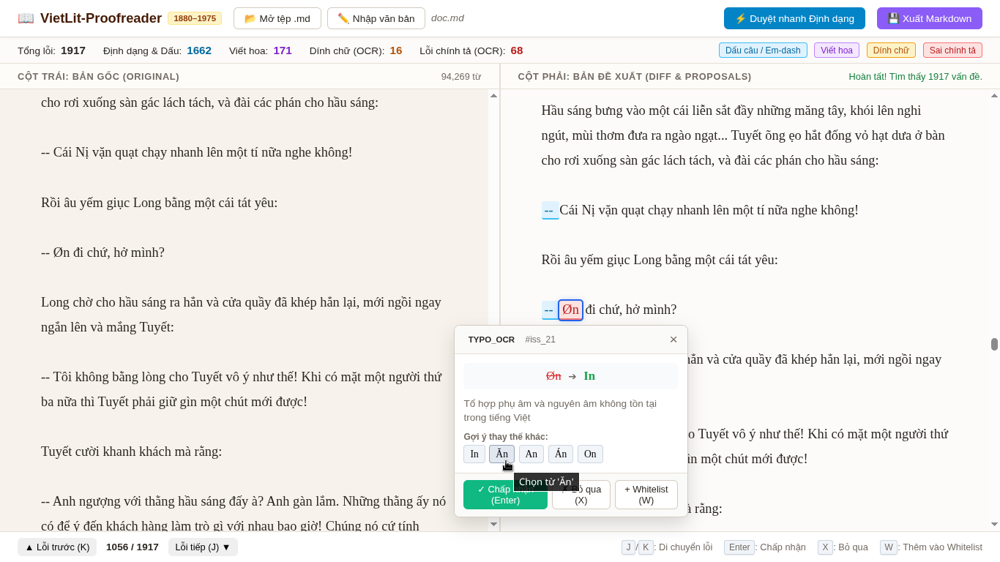

# Biên tập 1

*Thành thật mà nói thì mình không nghĩ được tên gì hay hơn*.

## Hướng dẫn thiết lập

Mình mới thử nghiệm trên Linux (Debian 12) nên không biết là chạy bên Windows hay MacOS như thế nào nữa....

Thiết lập `venv` và cài đặt các dependencies:

```
python3 -m venv .venv
source .venv/bin/activate
pip install -r requirements.txt
```

Rồi chạy:

```
python run.py
```

Nó sẽ hiện log kiểu như thế này trên Terminal:

```
INFO:     Uvicorn running on http://127.0.0.1:8000 (Press CTRL+C to quit)
INFO:     Started reloader process [12941] using WatchFiles
INFO:     Started server process [12943]
INFO:     Waiting for application startup.
```

Truy cập link `http://127.0.0.1:8000` bằng trình duyệt bạn đang dùng.


